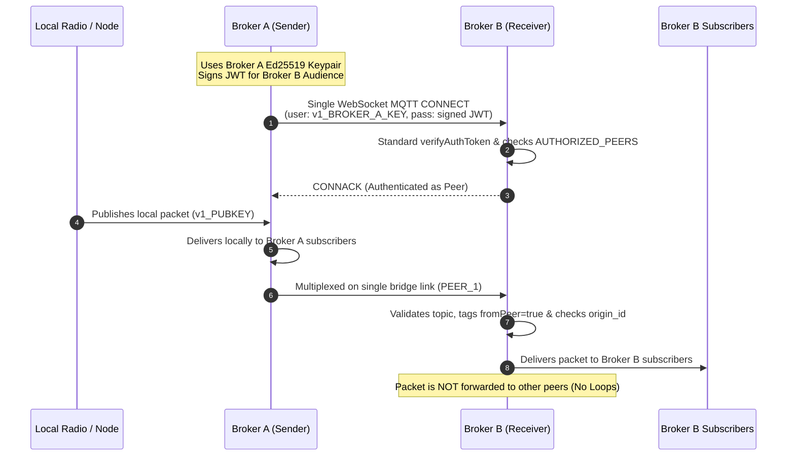
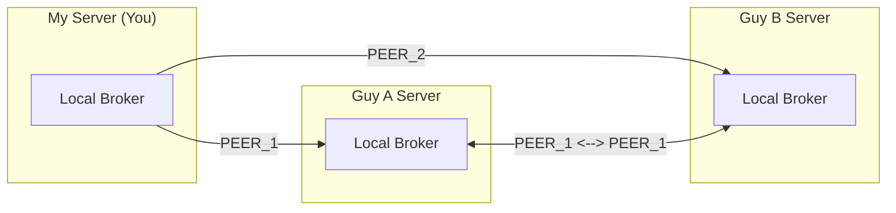

# Multi-Broker Peering & Packet Forwarding Guide

This guide explains how to connect multiple `meshcore-mqtt-broker` instances together to share MeshCore packet traffic across different servers and regions, while preventing duplicate messages and routing loops.

---

## 1. What It Does

When running multiple MeshCore MQTT brokers, you may want them to exchange radio and telemetry traffic with partner brokers. 

### Key Characteristics
- **Push-Based WebSocket Bridging**: A broker connects out to remote peer brokers over WebSocket MQTT (`ws://` or `wss://`), pushing forwarded packets directly.
- **Local-Only Forwarding (Loop Prevention)**: A broker only forwards packets that originated from its own locally connected mesh clients/radios. Packets received from a peer broker are delivered to local subscribers, but are **never re-forwarded** to other peers.
- **Preserved Origins**: Packets are delivered with the original node's public key, IATA location, SNR, RSSI, and payload intact.
- **Per-Origin Abuse Enforcement**: If a radio node on a peer broker sends abusive traffic, only that individual origin node is muted—the peer connection itself remains online.
- **Offline Bounded Queues**: If a remote peer broker restarts or is temporarily offline, packets buffer in a bounded FIFO queue and automatically drain upon reconnection. If the queue fills, the oldest packets are safely dropped to prevent memory exhaustion.

---

## 2. The 3-Step Setup Process

Setting up forwarding between two brokers (Broker A and Broker B) requires just two configuration changes:
1. **On the receiving broker**: Add a **Subscriber Role 4 (Peer)** credential in `.env`.
2. **On the sending broker**: Add an outbound **`PEER_N`** target in `.env`.



---

## 3. Step-by-Step Instructions

### Step 1: Find or Configure the Sender's Broker Public Key

Every broker has an Ed25519 peer identity. When starting up, the broker prints:
```text
  3. Peer Interconnect:
     Broker Identity: 4852B69364572B52...
```
*(If you want to pin a specific private key, set `PEER_PRIVATE_KEY` in `.env`. If omitted, the broker automatically generates a persistent identity saved to `data/peer-identity.json`).*

Copy the sender broker's 64-hex **Public Key**.

---

### Step 2: Authorize the Peer on the Receiving Broker

On the broker that will **receive** traffic (Broker B), add Broker A's public key to `AUTHORIZED_PEERS` in `.env`:

```bash
# Comma-separated list of authorized peer broker public keys
AUTHORIZED_PEERS=4852B69364572B52EFA1B6BB3E6D0ABED4F389A1CBFBB60A9BBA2CCE649CAF0E
```

> [!NOTE]
> Peer brokers authenticated via JWT can only publish to valid meshcore traffic topics (`packets`, `status`, `neighbors`, `raw`). They cannot publish to administrative `/internal` topics or remote serial consoles.

---

### Step 3: Configure the Outbound Bridge on the Sending Broker

On the broker that will **send** traffic (Broker A), add Broker B's URL and expected audience to `PEER_N` in `.env`:

```bash
# Format: PEER_N=URL:target_audience
PEER_1=wss://broker-b.yourdomain.com:443:broker_b_expected_audience

# Optional: Maximum queued packets during disconnections (default: 1000)
PEER_QUEUE_MAX_SIZE=1000
```

> [!TIP]
> `target_audience` is Broker B's `AUTH_EXPECTED_AUDIENCE` value. Broker A dynamically signs a fresh 24-hour MeshCore JWT token for Broker B's audience and automatically refreshes it before expiration.

Restart Broker A. In the console logs, you will see:
```text
[CONFIG] Loaded outbound peer: peer_1 -> wss://broker-b.yourdomain.com:443 (audience: broker_b_expected_audience)
[PEER_BRIDGE] Initializing 1 outbound peer bridge(s) (queue limit: 1000)
[PEER:peer_1] Connecting to wss://broker-b.yourdomain.com:443 via JWT [pubkey: 4852B693..., aud: broker_b_expected_audience]...
[PEER:peer_1] ✓ Connected to peer at wss://broker-b.yourdomain.com:443
```

---

## 4. Real-World Walkthrough: You + Guy A + Guy B

In this scenario:
- **You (My Server)** forward your local mesh traffic to **Guy A** and **Guy B**.
- **Guy A** and **Guy B** share traffic bidirectionally with each other (**Guy A <-> Guy B**).
- Neither Guy A nor Guy B forwards traffic back to **You**.
- Guy A does **not** duplicate your traffic when sharing with Guy B.



### Server Configuration Summary

| Server | Inbound Peer Authorization (`AUTHORIZED_PEERS`) | Outbound Peers Needed (`PEER_N`) |
| :--- | :--- | :--- |
| **My Server** | *(None needed for peers, since neither Guy A nor B pushes to you)* | `PEER_1=wss://guya.com:443:guya_audience`<br>`PEER_2=wss://guyb.com:443:guyb_audience` |
| **Guy A** | `AUTHORIZED_PEERS=MY_SERVER_KEY,GUY_B_KEY` | `PEER_1=wss://guyb.com:443:guyb_audience` |
| **Guy B** | `AUTHORIZED_PEERS=MY_SERVER_KEY,GUY_A_KEY` | `PEER_1=wss://guya.com:443:guya_audience` |

### Why Routing Loops Cannot Happen
1. When you publish packet $P_1$, it is forwarded to Guy A and Guy B.
2. When Guy A receives $P_1$, Guy A tags it as `fromPeer = true`.
3. When Guy A checks its outbound queue to Guy B, it sees $P_1$ was received from a peer, so it **does not** send $P_1$ to Guy B. Guy B only receives $P_1$ once (directly from you).
4. When Guy A generates a local packet $P_A$, Guy A forwards it to Guy B. Guy B delivers $P_A$ locally, but does not send it back to Guy A or to You.

---

## 5. Forwarded Topics & Payload Scope

### Forwarded Subtopics
- `meshcore/{IATA}/{PUBKEY}/packets` — LoRa radio packets, SNR, RSSI
- `meshcore/{IATA}/{PUBKEY}/status` — Node status, battery, telemetry
- `meshcore/{IATA}/{PUBKEY}/neighbors` — Neighbor node lists
- `meshcore/{IATA}/{PUBKEY}/raw` — Raw payload streams

### Filtered / Excluded Subtopics
- `meshcore/{IATA}/{PUBKEY}/internal` — **Blocked** (admin JWTs, trust metrics, client IPs)
- `meshcore/{IATA}/{PUBKEY}/serial/*` — **Blocked** (remote serial console commands and responses)
- `$SYS/*` — **Blocked** (internal broker stats)

---

## 6. Monitoring & Troubleshooting

### Log Prefixes
- `[PEER:peer_1]` — Outbound bridge client activity (connecting, queueing, forwarding).
- `[P:username]` — Inbound peer connection activity (authenticated peer publishing).
- `[O:pubkey]` — Local radio publisher connection.
- `[S:username]` — Standard subscriber connection.

### Common Issues

#### 1. Peer Connection Fails: `[ERROR] connect ECONNREFUSED`
- **Cause**: Remote broker is offline, host/port is wrong, or firewall is blocking the port.
- **Fix**: Verify the remote broker is running and accessible via browser or `curl`. Packets will safely buffer in the queue up to `PEER_QUEUE_MAX_SIZE`.

#### 2. Peer Publish Denied: `[AUTHZ] ✗ Peer publish denied (subtopic "internal" not allowed)`
- **Cause**: A client attempted to forward an administrative or non-whitelisted topic.
- **Fix**: Only traffic on `packets`, `status`, `neighbors`, and `raw` is permitted. Internal topics containing PII are intentionally protected.

#### 3. Subscriber Role Denied: `[AUTHZ] ✗ Publish denied (subscriber)`
- **Cause**: The inbound account on the receiving broker was configured with Role 1, 2, or 3 instead of Role 4.
- **Fix**: Ensure the receiving broker's `.env` specifies `:4` at the end:
  ```env
  SUBSCRIBER_N=username:password:4
  ```
