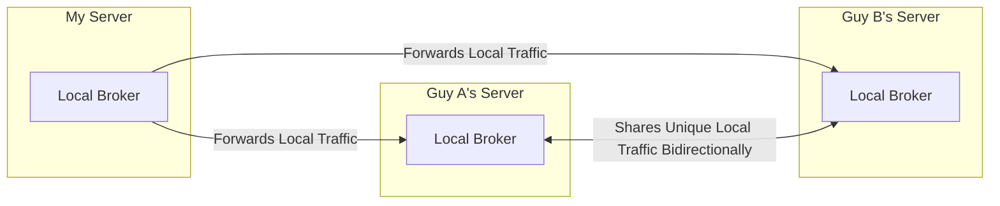

# Implementation Plan: Multi-Broker Packet Forwarding & Peering

## 1. Overview & Architecture

This implementation enables `meshcore-mqtt-broker` instances to peer with one another, forwarding traffic according to a defined topology while preventing forwarding loops and duplicates.

### Topology Example

### Core Design Decisions
1. **Loop Prevention (Local-Only Forwarding)**:
   - Each broker only forwards packets published directly by its own connected local clients/radios.
   - Packets received from peer brokers are delivered locally to subscribers but are **never re-forwarded** to other peers.
   - This naturally prevents ping-pong loops between Guy A and Guy B, and ensures Guy A never relays My Server's packets to Guy B.
2. **Inbound Peer Authentication (Subscriber Role 4: Peer)**:
   - Add `SubscriberRole.PEER = 4` to subscriber credentials (`SUBSCRIBER_N=username:password:4`).
   - Role 4 connections are allowed to publish across valid `meshcore/{IATA}/{PUBKEY}/{subtopic}` topics without requiring client credentials to match each packet's `origin_id` or topic public key.
   - Incoming publications from Role 4 clients are tagged with `fromPeer = true`.
3. **Outbound Forwarding & Queue Resilience**:
   - Outbound bridge manager loads `PEER_N=ws(s)://host:port/path:username:password` from configuration.
   - Uses a WebSocket MQTT client to maintain a persistent connection with exponential backoff and automatic reconnect.
   - Bounded in-memory FIFO queue (configurable, default 1,000 packets) buffers messages during brief disconnections, dropping the oldest if the buffer fills to protect system memory.
4. **Topic Scope**:
   - Forwarded subtopics: `packets`, `status`, `neighbors`, `raw`.
   - Excluded subtopics: `/internal`, `/serial/*`, `$SYS/*`.
5. **Abuse Detection**:
   - Full abuse detection (token bucket, duplicate detection, max packet size, anomaly tracking) is enforced against the packet's `origin_id`.
   - If an individual origin node exceeds thresholds, only that `origin_id` is silenced; the peer connection itself remains active and healthy.

---

## 2. Changes by Component

### A. Configuration (`src/config.ts` & `.env.example`)
- **Subscriber Role 4**: Update documentation and role typing in `.env.example` and comments.
- **Peer Config Parser**:
  - `loadPeerConfig()` to read `PEER_1`, `PEER_2`, ... and `PEER_QUEUE_MAX_SIZE` (default 1000).
  - Robust parser for `PEER_N` URLs containing colons, e.g. `ws://guy-a.example.com:8883:peeruser:peerpass`.

### B. Peer Bridge Client (`src/peer-bridge.ts`)
- New module `PeerBridgeManager`:
  - Instantiates outbound MQTT-over-WebSocket clients for each configured peer.
  - Manages connection lifecycle (connecting, connected, reconnecting, error logging).
  - Maintains a bounded FIFO queue per peer:
    - `enqueue(topic, payload, qos, retain)`
    - Drops oldest if queue exceeds `PEER_QUEUE_MAX_SIZE`.
    - Drains queue in order upon connection re-establishment.
  - Exposes `forwardLocalPacket(packet, client)` to be called by the broker.

### C. Broker Authorization & Routing (`src/server.ts`)
- **Add `SubscriberRole.PEER = 4`**:
  - In `aedes.authenticate`: identify Role 4 clients as `ClientType.PEER` or `ClientType.SUBSCRIBER` with `role: SubscriberRole.PEER`.
- **In `aedes.authorizePublish`**:
  - If client is Role 4 (Peer):
    - Verify topic format is `meshcore/{IATA}/{PUBKEY}/{subtopic}` where `{subtopic}` is one of `packets`, `status`, `neighbors`, or `raw`.
    - Validate IATA code and 64-hex PUBKEY format.
    - Parse JSON payload and verify `origin_id` is present and valid 64-hex key.
    - Tag packet with `fromPeer = true`.
    - Authorize publish.
- **In `aedes.on('publish')` / Broadcast Flow**:
  - Check if packet is from a local client (`!packet.fromPeer`).
  - If local and topic matches allowed forwarding patterns (`packets`, `status`, `neighbors`, `raw`):
    - Hand packet to `PeerBridgeManager.forwardLocalPacket(packet)`.
- **Abuse Detector Integration**:
  - Update `abuseDetector.recordPacket` / `shouldSilencePacket` to resolve client trust state using `origin_id` from the payload, allowing peer-forwarded packets to be tracked and silenced per origin node without dropping peer links.

### D. Documentation (`README.md` & `.env.example`)
- Document Role 4 configuration for peering.
- Document `PEER_N` configuration options, reconnection behavior, and topology examples.
- Provide a setup walkthrough for setting up hub-and-spoke or peer-to-peer broker forwarding.

---

## 3. Verification & Testing

1. **Unit / Integration Tests**:
   - Verify `PEER_N` string parsing (various URL formats, ports, paths, credentials).
   - Verify Role 4 authentication and authorization:
     - Allows publishing with mismatched `origin_id` and topic pubkey.
     - Rejects unauthorized subtopics (`/internal`, `/serial/*`).
   - Verify loop prevention:
     - Local publisher -> queued to outbound peers.
     - Peer publisher (`fromPeer = true`) -> delivered to local subscribers, but NOT queued to outbound peers.
   - Verify queue limits:
     - When disconnected, enqueuing > limit drops oldest and preserves newest.
2. **End-to-End Multi-Broker Simulation**:
   - Spin up two broker instances locally on distinct ports (e.g. 8883 and 8884).
   - Configure Broker 1 to peer to Broker 2.
   - Publish a packet to Broker 1 via simulated MeshCore client:
     - Confirm Broker 2 receives and delivers the packet to its local subscribers.
     - Confirm Broker 2 does not attempt to echo the packet back.
